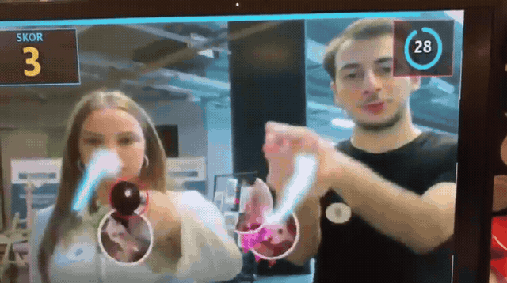
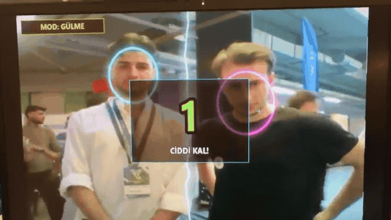
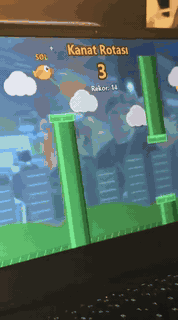
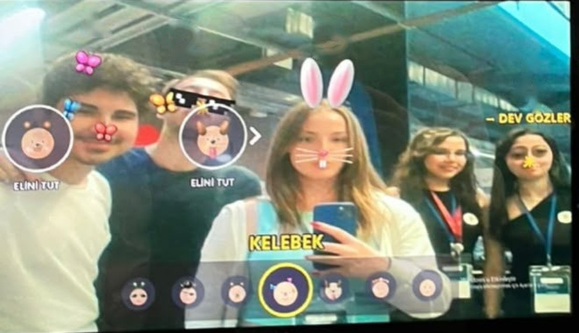
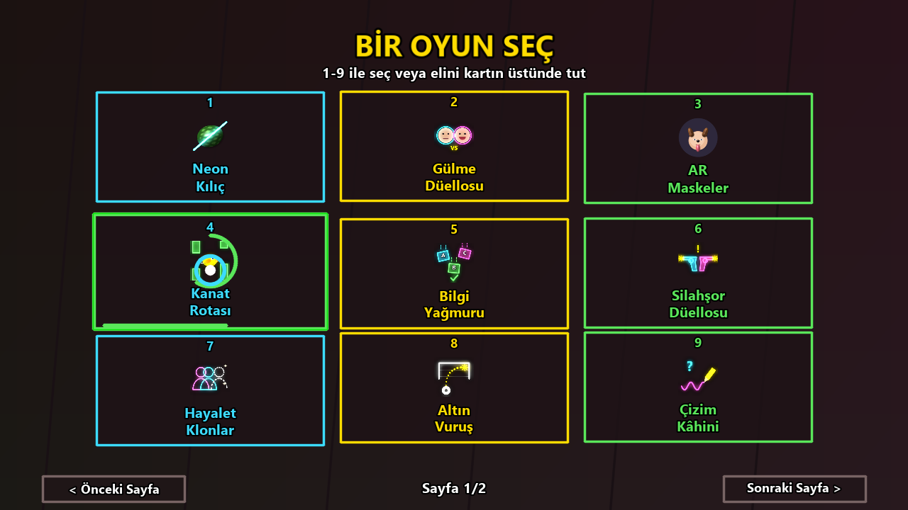
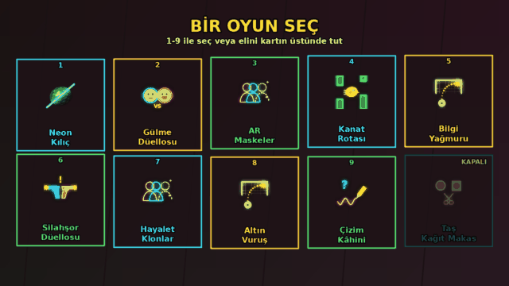
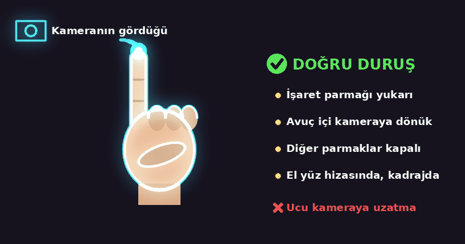

# Touchless Arcade — Stant Kamera Oyunları

[](https://github.com/Enesttombas/Touchless-Arcade/actions/workflows/ci.yml)
[](https://www.python.org/downloads/release/python-3119/)
[](https://www.microsoft.com/windows)
[](LICENSE)

**Bir kamera, bir ekran ve parmağın yeter.** Kumanda yok, dokunmatik ekran yok: kameranın karşısına geç ve sadece parmağınla oyna.

Bu oyunları Nişantaşı Üniversitesi'nin kulüp tanıtım haftasında, AR-GE Kulübü standına uğrayanlar biraz eğlensin diye yaptık. Stant bitti ama oyunlar duruyor: bir akşam evde arkadaşınla ya da çocuğunla laptopun karşısına geçip deneyebilirsin.

*We made these games so visitors at our R&D Club booth at Nişantaşı University could have some fun. The booth is over, but the games are still here: try them at home with a friend or your kids.* [English ↓](#english)

<br/>

<div align="center">

**1.** Aşağıdaki düğmeyle indir &nbsp;→&nbsp; **2.** ZIP'e sağ tıkla, **Tümünü ayıkla** &nbsp;→&nbsp; **3.** Açılan klasörde **`BASLAT.bat`**'a çift tıkla

Oyunun çalışması için gereken tüm dosyalar paketin içinde; ayrıca bir şey indirmen ya da kurman gerekmez.

<br/>

<a href="https://github.com/Enesttombas/Touchless-Arcade/releases/latest/download/Touchless-Arcade-Windows.zip"></a>

</div>

<br/>

## Stantta canlı

<div align="center">

<a href="docs/media/canli/neon-kilic.mp4"></a>

**Neon Kılıç**: iki oyuncu birlikte dilimliyor. Tur başında **Meyve** ya da **Meme** modu seçilir; bu klip Meme modundan.

<a href="docs/media/canli/gulme-duellosu.mp4"></a>

**Gülme Düellosu**: iki kişi yarışır, ilk gülen kaybeder.

<a href="docs/media/canli/kanat-rotasi.mp4"></a>

**Kanat Rotası**: kuşu parmağınla uçur.



**AR Maskeler**: kadrajdaki herkes kendi maskesini seçiyor.

</div>

<sub>Üniversite stantında gerçek oyunculardan kayıtlar. Tam videoyu açmak için önizlemeye tıkla.</sub>

## Ekran görüntüleri

<div align="center">
  
  <br/>
  
  <p><sub>Görseller oyunun kendi render motoruyla sentetik verilerle üretildi; canlı kamera kaydı değildir.</sub></p>
</div>

## Oyunlar

| | Oyun | Nasıl oynanır |
|---|---|---|
| 1 | **Neon Kılıç** | İşaret parmağın kılıç olur; **Meyve** ya da **Meme** modunda uçuşanları dilimle. |
| 2 | **Gülme Düellosu** | İki kişi karşı karşıya: ilk gülen ya da göz kırpan kaybeder. |
| 3 | **AR Maskeler** | Yüzüne gerçek zamanlı 3B maskeler ve filtreler. |
| 4 | **Kanat Rotası** | Parmağının yüksekliğiyle kuşu boruların arasından geçir. |
| 5 | **Bilgi Yağmuru** | Düşen doğru cevabın altına bedeninle koş. |
| 6 | **Silahşor Düellosu** | "ATEŞ!" yazınca elini en hızlı kaldıran kazanır. |
| 7 | **Hayalet Klonlar** | Zaman klonların ve görünmezlik pelerini. |
| 8 | **Altın Vuruş** | Parmağını topa koy, kalede nişan aldığın yere yol çiz. Neon kaleci yalandan yatıp köşeye uçar. |
| 9 | **Çizim Kâhini** | Havada çiz; yapay zekâ ne çizdiğini tahmin etsin. |

*Taş Kağıt Makas* menüde soluk ve devre dışı bir kart olarak durur.

## Kurulum ve çalıştırma

1. **[⬇ İndir](https://github.com/Enesttombas/Touchless-Arcade/releases/latest/download/Touchless-Arcade-Windows.zip)**: yaklaşık 200 MB'lık hazır paket iner.
2. ZIP'e sağ tıkla → **Tümünü ayıkla**.
3. Açılan klasördeki **`BASLAT.bat`**'a çift tıkla.

Paketin içinde oyunun kendi Python'u ve tüm kütüphaneleri hazır gelir: ilk açılışta hiçbir şey indirilmez, bilgisayarına bir şey kurulmaz. Windows 10/11 (64 bit) ve bir USB ya da dahili kamera yeterli.

<sub>Kaynak kodu indirdiysen (<b>Code → Download ZIP</b>), <code>BASLAT.bat</code> ilk açılışta gerekenleri kendisi indirip kurar (internet gerekir, 3-5 dakika).</sub>

> Windows "bilinmeyen yayımcı" uyarısı gösterirse **Ek bilgi → Yine de çalıştır**'a bas. Kamera açılmazsa: Ayarlar → Gizlilik → Kamera → **Masaüstü uygulamalarının kameraya erişmesine izin ver**.

## Kontroller

Kameranın parmağını en iyi algılaması için **işaret parmağını yukarı kaldır, avuç içini kameraya dön**, diğer parmakları kapat. Parmak ucunu doğrudan kameraya uzatırsan kamera parmağı kısaltılmış görür ve takip kopabilir.

<div align="center"></div>


| Ne | Hareketle | Klavyeyle |
|---|---|---|
| Oyun seç | Elini kartın üstünde 1 sn tut | `1`–`9` |
| Menüye dön | Sol alt köşede avucunu 3 sn aç | `M` |
| Tam ekran / çıkış | | `F` / `Q` |

## Nasıl çalışıyor?

- Yüz, el ve beden takibi: **Google MediaPipe**. Çizim tanıma: **Quick, Draw!** verisiyle eğitilmiş küçük bir **ONNX** ağı. Görüntü işleme: **OpenCV**.
- Her şey bilgisayarda yerel çalışır. Kamera görüntüsü yalnız bellekte işlenir; diske yazılmaz, internete gönderilmez.
- Ayrıntılar: [mimari](docs/architecture.md) · [sorun giderme](docs/troubleshooting.md) · [lisanslar](THIRD_PARTY_NOTICES.md) · [değişiklikler](CHANGELOG.md)

## Geliştirme

```cmd
app\.venv\Scripts\python.exe -m pytest -q tests
app\.venv\Scripts\python.exe tools\render_preview.py --quick
```

Kodun yapısı: `oyunlar/` (oyunlar ve menü), `stand/` (ortak çizim/efekt kütüphanesi), `app/modeller/` (MediaPipe modelleri), `tests/`.

---

<a name="english"></a>
## English

**Touchless Arcade** is a set of 9 camera games you play with just your finger in front of a mirrored live camera. No controller or touch screen needed. We made it so visitors at our R&D Club booth during Nişantaşı University's club week could have some fun. The booth is over, but the games are still here: try them at home with a friend or your kids.

**Run it on Windows:**
1. **[Download the ZIP](https://github.com/Enesttombas/Touchless-Arcade/releases/latest/download/Touchless-Arcade-Windows.zip)** and extract it (right-click → Extract All).
2. Double-click **`BASLAT.bat`**.

The download is a ready-to-run package (about 200 MB) with its own portable Python and all libraries inside: nothing is installed on your PC and nothing is downloaded on first launch.

**Controls:** raise your index finger with the palm facing the camera (don't point the fingertip straight at the lens). Hold your hand over a card for 1 s to pick a game. Hold an open palm in the bottom-left corner for 3 s to return to the menu. Keyboard: `1`–`9` select, `M` menu, `F` fullscreen, `Q` quit.

**Live demos:** see the clips under *Stantta canlı* above, recorded with real players at a university booth.

**Tech:** MediaPipe (face, hands, pose), OpenCV, ONNX Runtime (a Quick, Draw! sketch classifier) and pygame-ce audio. Everything runs locally on the CPU, and camera frames never leave memory.

## Lisans

[MIT](LICENSE). Üçüncü taraf modellerin lisansları: [THIRD_PARTY_NOTICES.md](THIRD_PARTY_NOTICES.md).
