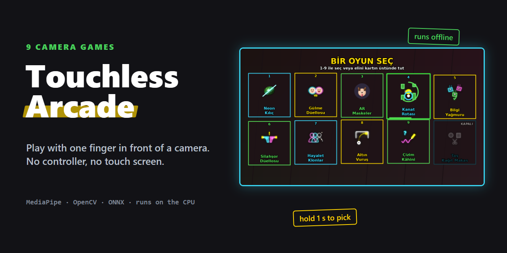
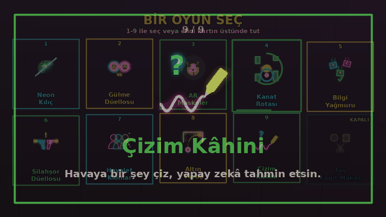
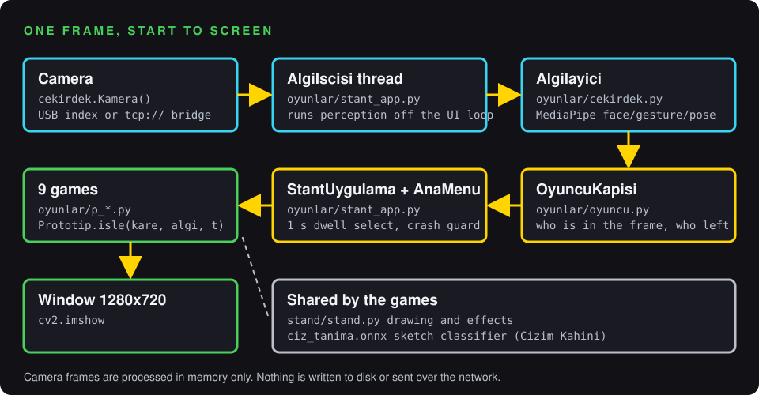
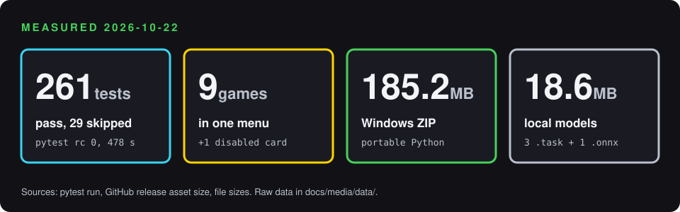

<p align="center"></p>
<p align="center"><a href="README.md">English</a> · <b>Türkçe</b></p>

<p align="center">
<a href="https://github.com/Enesttombas/Touchless-Arcade/actions/workflows/ci.yml"></a>


<a href="LICENSE"></a>
</p>

Touchless Arcade, aynalanmış canlı kameranın karşısında parmağınla, yüzünle ya da bedeninle oynadığın dokuz kamera oyunu. Nişantaşı Üniversitesi kulüp tanıtım haftasında AR-GE Kulübü standı için yaptım: standın önünden geçenleri durdurmak ve birkaç dakikalığına eğlendirmek için.

<p align="center"><a href="https://github.com/Enesttombas/Touchless-Arcade/releases/latest/download/Touchless-Arcade-Windows.zip"></a></p>
<p align="center">İndir · ZIP'e sağ tıkla, <b>Tümünü ayıkla</b> · <code>BASLAT.bat</code>'a çift tıkla</p>

<p align="center"><a href="docs/media/canli/neon-kilic.mp4"></a></p>
<p align="center"><sub>Stantta gerçek oyunculardan kayıt. Tam videoyu açmak için tıkla.</sub></p>

## Ne yapar

**Tek parmakla oyna.** İşaret parmağını kaldır, oyun onu takip etsin. Oyun seçmek için parmağını menüdeki kartın üstünde bir saniye tut; stantta klavye ya da fare gerekmez.

<p align="center"><a href="docs/media/canli/kanat-rotasi.mp4"></a></p>

**Aynı anda iki oyuncu.** Düellolar aynı karedeki iki kişiyi takip eder: Gülme Düellosu'nda ilk gülen kaybeder, Neon Kılıç'ta iki kılıç birlikte dilimler. AR Maskeler'de kadrajdaki herkes kendi maskesini alır.

<p align="center"><a href="docs/media/canli/gulme-duellosu.mp4"></a></p>

**Dokuz oyun, tek menü.** Bütün oyunlar aynı kamerayı ve aynı algı iş parçacığını paylaşır; oyun değiştirmek anında olur.

| | Oyun | Nasıl oynanır |
|---|---|---|
| 1 | **Neon Kılıç** | İşaret parmağın kılıç olur; **Meyve** ya da **Meme** modunda uçuşanları dilimle. |
| 2 | **Gülme Düellosu** | İki kişi karşı karşıya: ilk gülen ya da göz kırpan kaybeder. |
| 3 | **AR Maskeler** | Yüzüne gerçek zamanlı 3B maskeler ve filtreler. |
| 4 | **Kanat Rotası** | Parmağının yüksekliğiyle kuşu boruların arasından geçir. |
| 5 | **Bilgi Yağmuru** | Düşen doğru cevabın altına bedeninle koş. |
| 6 | **Silahşor Düellosu** | "ATEŞ!" yazınca elini en hızlı kaldıran kazanır. |
| 7 | **Hayalet Klonlar** | Zaman klonları ve görünmezlik pelerini. |
| 8 | **Altın Vuruş** | Parmağını topa koy, kalede nişan aldığın yere yol çiz. Neon kaleci yalandan yatıp köşeye uçar. |
| 9 | **Çizim Kâhini** | Havada çiz; küçük bir sinir ağı ne çizdiğini tahmin etsin. |

*Taş Kağıt Makas* menüde soluk ve devre dışı bir kart olarak durur.

<p align="center"></p>
<p align="center"><sub>Oyunun kendi render motoruyla sentetik girdiden üretildi; canlı kamera kaydı değildir.</sub></p>

## Nasıl çalışır

<p align="center"></p>

- `cekirdek.Kamera()` USB kamerayı açar; kamera ikinci bir laptoptaysa `kamera_kopru.py` üzerinden `tcp://` akışını okur.
- `stant_app.py` içindeki `AlgiIscisi`, `cekirdek.py`'deki `Algilayici`'yı kendi iş parçacığında çalıştırır: MediaPipe yüz, el hareketi ve beden modelleri (`app/modeller/*.task`).
- `OyuncuKapisi` (`oyuncu.py`) kimin oynadığına karar verir. `StantUygulama` ve `AnaMenu` menüyü, bekleyerek seçmeyi ve çökme yalıtımını yönetir: üç kez çöken oyun seni menüye geri gönderir.
- `oyunlar/p_*.py` içindeki her oyun `Prototip.isle(kare, algi, t)` sunar ve ortak `stand/stand.py` ile çizer. Çizim Kâhini ayrıca Quick, Draw! verisiyle eğitilmiş `ciz_tanima.onnx` sınıflandırıcısını kullanır.

Ayrıntılar: [mimari](docs/architecture.md) · [sorun giderme](docs/troubleshooting.md).

## Sayılar

<p align="center"></p>

2026-10-22'de ölçüldü (Windows 11, Python 3.11): `python -m pytest -q tests` 478 sn'de 261 geçen ve 29 atlanan testle 0 çıkış koduyla bitti. Paket boyutu GitHub sürüm dosyasından, model boyutları `app/modeller/` ve `oyunlar/modeller/` içindeki dosyalardan. Ham veri: [`docs/media/data/`](docs/media/data/).

## Hızlı başlangıç

1. **[ZIP'i indir](https://github.com/Enesttombas/Touchless-Arcade/releases/latest/download/Touchless-Arcade-Windows.zip)** (185 MB).
2. Sağ tıkla, **Tümünü ayıkla**'yı seç.
3. Açılan klasördeki **`BASLAT.bat`**'a çift tıkla.

Paketin içinde oyunun kendi taşınabilir Python'u ve bütün kütüphaneleri gelir: bilgisayarına bir şey kurulmaz, ilk açılışta bir şey indirilmez. Windows 10/11 (64 bit) ve bir USB ya da dahili kamera yeterli.

Kaynak kodu indirdiysen (**Code → Download ZIP**), `BASLAT.bat` ilk açılışta gerekenleri kendisi kurar (internet gerekir, 3-5 dakika).

> Windows "bilinmeyen yayımcı" uyarısı gösterirse **Ek bilgi → Yine de çalıştır**'a bas. Kamera açılmazsa: Ayarlar → Gizlilik → Kamera → **Masaüstü uygulamalarının kameraya erişmesine izin ver**.

## Kullanım

İşaret parmağını kaldır, **avuç içini kameraya dön**, diğer parmakları kapat. Parmak ucunu doğrudan kameraya uzatırsan kamera parmağı kısa görür ve takip kopabilir.

<p align="center"></p>

Oyun seçmek için elini kartın üstünde 1 sn tut. Menüye dönmek için açık avucunu sol alt köşede 3 sn tut. Klavye: `1`-`9` seçer, `M` menü, `F` tam ekran, `Q` çıkış; kısayollar sol altta hep yazılı.

Geliştirme:

```cmd
app\.venv\Scripts\python.exe -m pytest -q tests
app\.venv\Scripts\python.exe tools\render_preview.py --quick
```

Kodun yapısı: `oyunlar/` (oyunlar ve menü), `stand/` (ortak çizim ve efektler), `app/modeller/` (MediaPipe modelleri), `tests/`.

## Sınırlar

- Yalnız Windows. ZIP ve `BASLAT.bat` Windows 10/11 64 bit için hazırlanıp test edildi.
- Sürüm imzasız; Windows SmartScreen ilk açılışta uyarır.
- Takip ışığa ve kamera açısına bağlı. Arkadan gelen ışık ve kameraya uzatılan parmak ucu en sık sorun; [sorun giderme](docs/troubleshooting.md).
- Oyun içi metinler Türkçe.

## Lisans

[MIT](LICENSE). Üçüncü taraf model lisansları: [THIRD_PARTY_NOTICES.md](THIRD_PARTY_NOTICES.md). Değişiklikler: [CHANGELOG.md](CHANGELOG.md).

Önceki README [docs/NOTES.md](docs/NOTES.md) içinde duruyor.
